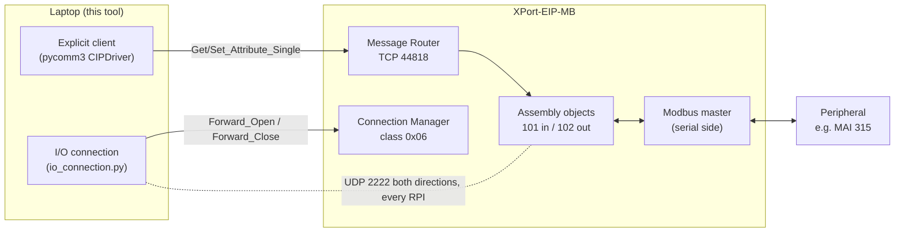
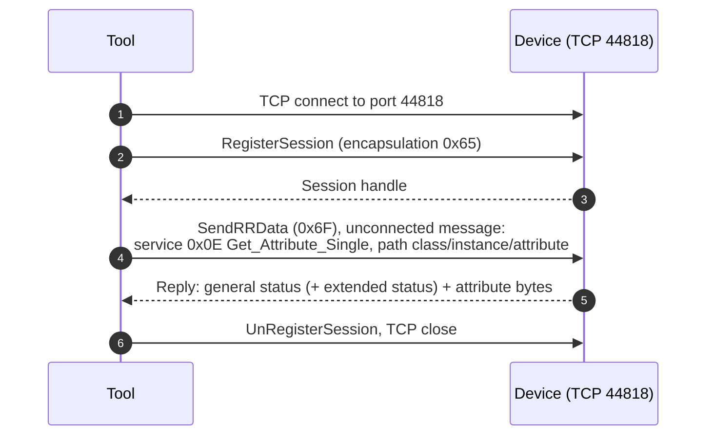
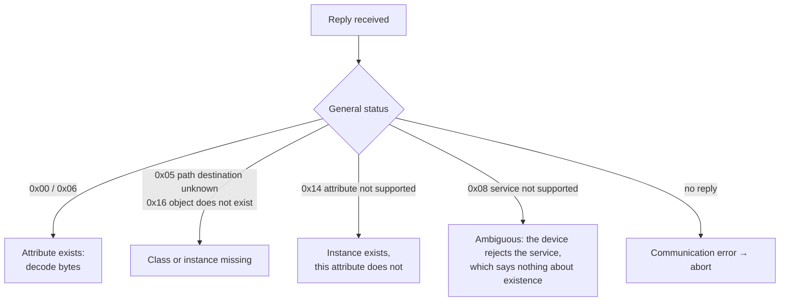
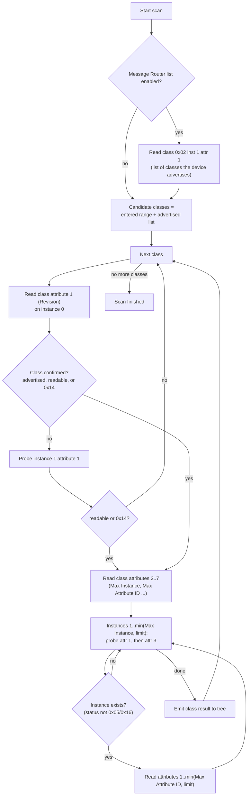
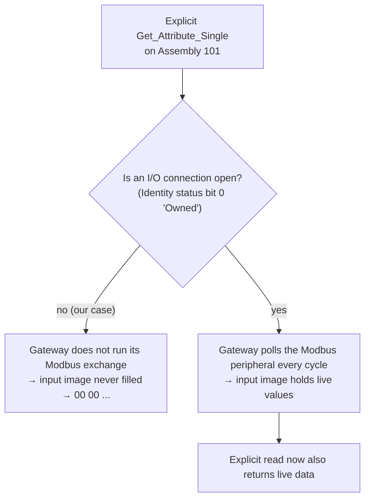
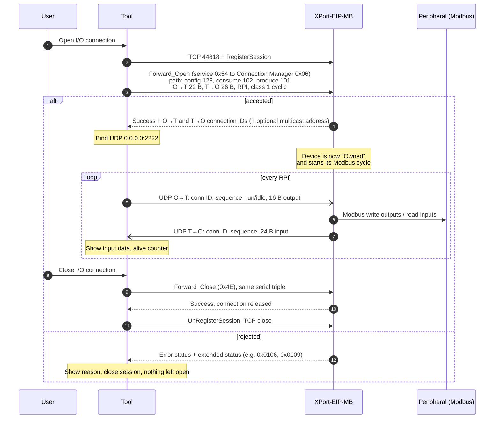
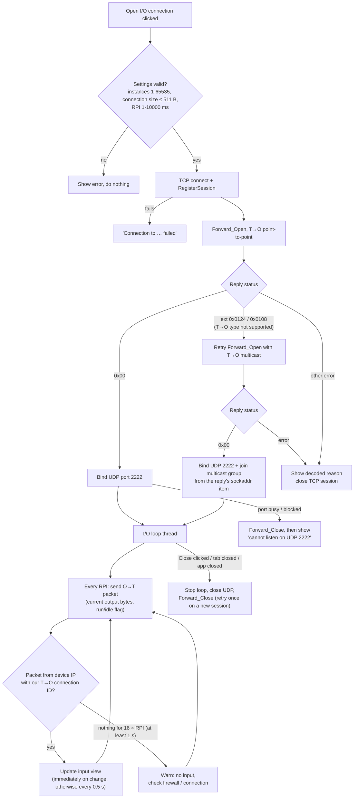
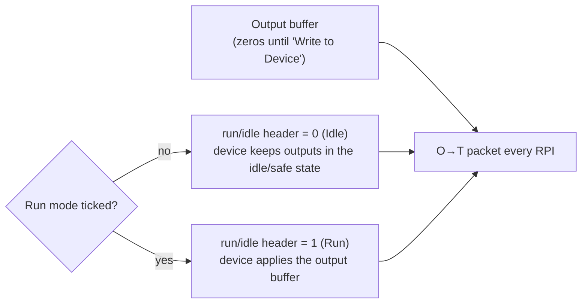
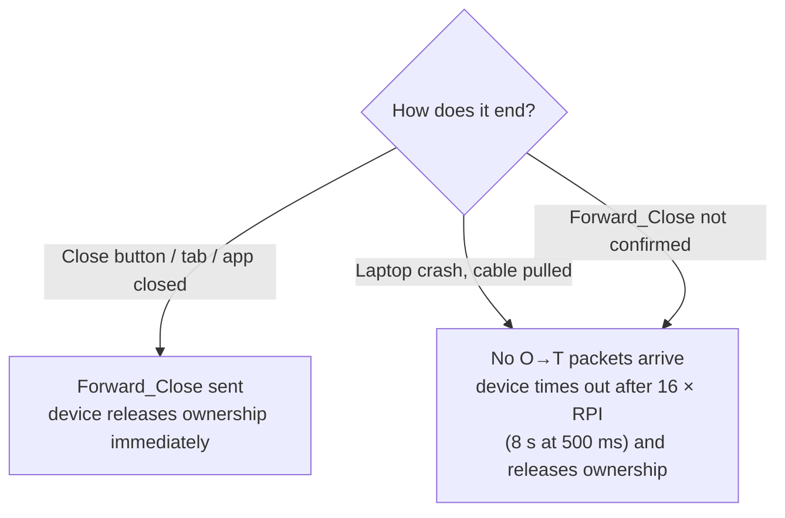
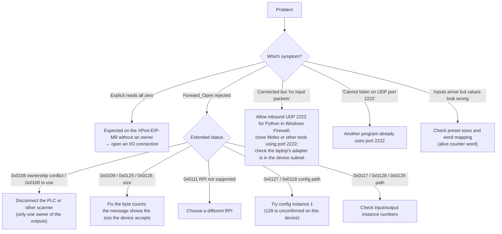

# How the tool talks to EtherNet/IP devices

This page explains what the tool sends on the network to reach a device, read its data,
and exchange live I/O, and why each step is expected to work. The diagrams use Mermaid
and render on GitHub and in the VS Code Markdown preview.

Contents:

1. [Two kinds of EtherNet/IP traffic](#1-two-kinds-of-ethernetip-traffic)
2. [Explicit messaging (CIP Objects, CIP Scanner, Read Once)](#2-explicit-messaging)
3. [Why explicit reads returned only zeros](#3-why-explicit-reads-returned-only-zeros)
4. [Cyclic I/O connection (Open I/O connection)](#4-cyclic-io-connection)
5. [Packet layouts](#5-packet-layouts)
6. [Troubleshooting map](#6-troubleshooting-map)

---

## 1. Two kinds of EtherNet/IP traffic

| | Explicit messaging | Implicit (cyclic) I/O |
|---|---|---|
| Transport | TCP 44818 | UDP 2222 (set up over TCP 44818) |
| Pattern | Request → reply, on demand | Both sides send every RPI, no replies |
| Used by | CIP Objects, CIP Scanner, Device I/O *Read Once / Polling / Write to Device* (not connected) | Device I/O *Open I/O connection* |
| Device ownership | None; the device does not know a "master" exists | The tool becomes the **owner** of the assemblies, like a PLC |
| Typical use | Configuration, identity, diagnostics | Process data (inputs/outputs) |



---

## 2. Explicit messaging

Every explicit request (one attribute read in CIP Objects, each probe of the CIP Scanner,
Device I/O *Read Once*) follows the same steps:



**Why it works:** every EtherNet/IP device must have a Message Router that accepts
unconnected requests on TCP 44818 (CIP Vol. 2). The request path is sent directly to the
target (`route_path=False`), with no backplane routing, because the XPort is the end
device and not a PLC chassis.

How the reply status is read:



### CIP Scanner flow

The scanner is explicit messaging in a loop. It only uses reads and never writes.



**Why the "confirmed?" check matters:** some devices answer `0x08` for *every* unknown
class. Without that check, the scanner would probe up to 200 instances of each of 255
classes that do not exist.

---

## 3. Why explicit reads returned only zeros

The XPort-EIP-MB scan of 192.168.20.25 showed:

- Assembly 101 (input) and 102 (output) exist and have the right sizes (24 / 16 bytes for the MAI 315).
- Both read back as **all zero bytes**. The device really sent zeros; this is not a decoding problem.
- Identity attribute 5 (Status) = `0x0000`, so **bit 0 "Owned" is clear**: no connection owns the device.
- The Molex tool showed zeros too, but a PLC got real data.



**Conclusion:** the gateway only exchanges data with the serial peripheral while a scanner
owns its assemblies. That is what a PLC does, and it explains why the PLC saw data and the
explicit tools did not.

> This is inferred from the device's behaviour, not from a vendor document. It was
> confirmed in practice: as soon as the tool opened an I/O connection, real values appeared.

---

## 4. Cyclic I/O connection

### 4.1 Full sequence



The sizes shown are for the MAI 315 preset: 16 output bytes + 6 header bytes = 22, and
24 input bytes + 2 = 26.

### 4.2 What the tool does, step by step (decision view)



### 4.3 Why each Forward_Open field is chosen

| Field | Value | Why |
|---|---|---|
| Connection path | `20 04 24 80 2C 66 2C 65` | Class 0x04 Assembly, config instance 128, then the **consumed** point (O→T output 102) and **produced** point (T→O input 101). CIP requires this order. Instances above 255 use 16-bit segments. |
| Transport class/trigger | `0x01` | Class 1, cyclic production, the standard for PLC I/O. |
| O→T size | output bytes + 2 + 4 | 2-byte CIP sequence count plus a 4-byte run/idle header, which is how adapters normally expect outputs. |
| T→O size | input bytes + 2 | Inputs are "modeless": only the sequence count, no run/idle header. |
| Network parameters | point-to-point, scheduled priority, fixed size | Point-to-point avoids needing multicast on the laptop; the multicast retry covers devices that refuse it. |
| RPI | user-selected (default 500 ms) | Slow enough for a Modbus gateway with serial polling behind it. The device may reject an RPI it cannot meet (`0x0111`). |
| Timeout multiplier | 2 → ×16 | The device drops the connection after 16 missing RPIs. This bounds how long outputs stay active if the laptop disappears. |
| O→T connection ID | 0 | The target assigns it and returns it in the reply. |
| T→O connection ID | random | Chosen by the tool and used to recognise its own input packets. |
| Serial / Vendor 0xFFFE / Originator serial | random per connection | Together these identify the connection. Forward_Close must repeat them exactly, so the device knows which connection to release. |

**Why this is expected to work:** this is the same Forward_Open that any EtherNet/IP scanner
(PLC, Molex in scanner mode, etc.) sends. The adapter cannot tell the tool apart from a PLC.
Once it accepts the request, CIP requires it to produce T→O data every RPI and to consume
our O→T data. That is the state in which the XPort runs its Modbus exchange.

### 4.4 Run / Idle



- After *Write to Device*, the bytes stay in the buffer and are resent every RPI until you write something else or close.
- Data shorter than the output size is zero-padded; longer data is truncated.
- What the peripheral does in *Idle* depends on the gateway's configuration (usually it holds or clears its outputs).

### 4.5 Ending the connection safely



Either way, the device ends up unowned, so a PLC can connect afterwards.

---

## 5. Packet layouts

UDP O→T (tool → device), little-endian:

```text
02 00                                   item count = 2
02 80 08 00 <O→T conn ID:4> <seq:4>     sequenced address item (0x8002)
B1 00 <len:2>                           connected data item (0x00B1)
  <CIP seq:2> <run/idle:4> <output data: N bytes>
```

UDP T→O (device → tool):

```text
02 00
02 80 08 00 <T→O conn ID:4> <seq:4>
B1 00 <len:2>
  <CIP seq:2> <input data: N bytes>
```

The tool ignores packets whose source IP or T→O connection ID does not match.

---

## 6. Troubleshooting map



---

Source files: [`eip_tool/io_connection.py`](../eip_tool/io_connection.py) (Forward_Open, UDP loop,
Forward_Close), [`eip_tool/device_io.py`](../eip_tool/device_io.py) (Device I/O tab),
[`eip_tool/cip_scanner.py`](../eip_tool/cip_scanner.py), and
[`eip_tool/cip_objects.py`](../eip_tool/cip_objects.py).
